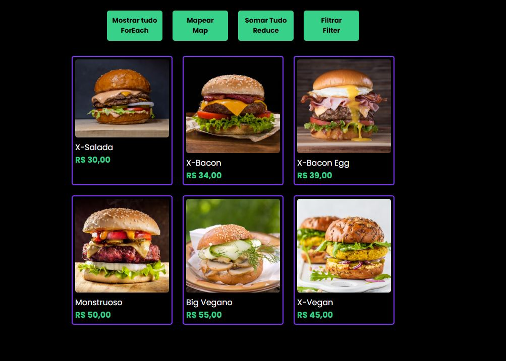
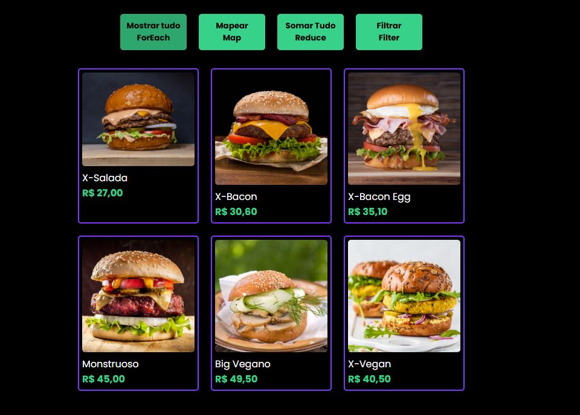
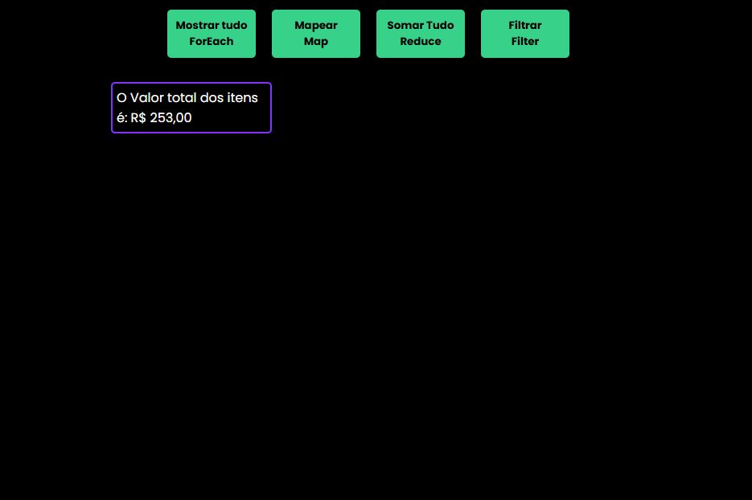
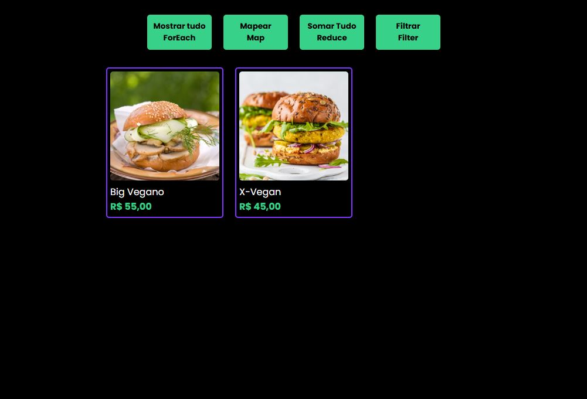

<h1>Projeto Hambúrguer</h1>
 

Projeto feito para mostrar todas as opções de hambúrguer com preço normal, com 10% de desconto, a soma do total com preço normal e por último, filtrado apenas com os veganos.

Utilizei no projeto como prática de aprendizado:
  -HTML:5
  -CSS
  -JavaScript (ForEach, Map, Reduce e Filter)
    

 
   

   
 
   

 

 

 

 

